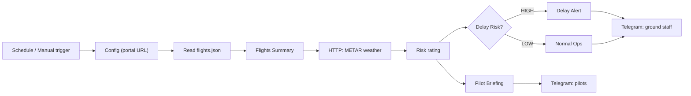

# ✈️ Airline Operations Automation with n8n

**A weather-aware alert system and role-based web portal for pilots, ground staff and passengers, built with [n8n](https://n8n.io) and running entirely on a laptop.**


> **Disclaimer:** This is an educational prototype. Flights, crew, passengers, gates and checklists are **synthetic demo data**. Weather and air traffic are live, but this project must **not** be used for real flight planning or operational decisions. Airline names are used for illustration only, and the project has no affiliation with any airline.

---

## Table of contents

1. [What it does](#what-it-does)
2. [Architecture](#architecture)
3. [Features](#features)
4. [Repository structure](#repository-structure)
5. [Prerequisites](#prerequisites)
6. [Quick start](#quick-start)
7. [Configuration](#configuration)
8. [Using the portal](#using-the-portal)
9. [Boarding passes and QR codes](#boarding-passes-and-qr-codes)
10. [Data](#data)
11. [How the risk rule works](#how-the-risk-rule-works)
12. [Screenshots](#screenshots)
13. [Troubleshooting](#troubleshooting)
14. [Limitations](#limitations)
15. [Roadmap](#roadmap)
16. [Data sources and credits](#data-sources-and-credits)
17. [License](#license)

---

## What it does

Three groups need different views of the same flight:

| Audience | What they get |
|---|---|
| 👨‍✈️ **Pilots** | Go/caution weather banner, departure and destination weather (with raw METAR), pre-flight checklist, crew, load summary |
| 🧳 **Ground staff** | Delay-risk alerts, boarding progress, full passenger manifest, other departures from the same airport |
| 🧍 **Passengers** | Flight status, gate, boarding time, crew, weather, reached by scanning a QR code on their boarding pass |

The project is made of **two connected n8n workflows**:

- **Airline Ops Weather System (push):** on a schedule, fetches live airport weather, applies a risk rule and sends alerts to Telegram. Each alert links to the dashboard of the flights affected.
- **Passenger Flight Status Page (pull):** a webhook-driven portal. Every visit builds a fresh HTML page for the requested flight and role.

Nothing is hosted in the cloud. Everything runs locally in Docker.

---

## Architecture

### Push: Airline Ops Weather System



### Pull: Passenger Flight Status Page

```mermaid
flowchart LR
  Q["QR code or link"] --> WH["Webhook"]
  WH --> F["Read flights.json"]
  F --> FD["Flight Data"]
  FD --> P["Read passengers.csv"]
  P --> PD["Passenger Data"]
  PD --> WX["HTTP: METAR weather"]
  WX --> LT["HTTP: adsb.lol live traffic"]
  LT --> BP["Build Page (HTML)"]
  BP --> RW["Respond to Webhook"]
```



**Push and pull working together:** alerts reach people's phones, and the links in those alerts open the matching dashboards in the portal. Both workflows use the same data files and the same risk rule.

---

## Features

- 🌦️ Live airport weather from METAR reports (no API key)
- ⚠️ Automatic risk rating and Telegram alerts for pilots and ground staff
- 🔗 Alerts include deep links to the pilot or ground dashboard of the next departures
- 🖥️ One web address, four pages: front page, pilot, ground staff, passenger
- 🔐 Role-based content: passengers never see other passengers' names
- ⏱️ Boarding-time sync: the page shows a live phase (check-in, boarding, gate closing, departed) with a progress bar
- 📡 Live radar of real aircraft within 40 nm of the departure airport (free ADS-B data from adsb.lol)
- 🧾 Generates demo boarding passes and an e-ticket as PDFs, each with a QR code
- 📊 Synthetic dataset: 1,000 flights and 15,066 passengers
- 🏠 Fully local: no hosting, no paid services

---

## Repository structure

Suggested layout for this repository:

```
.
├── workflows/
│   ├── airline-ops-weather-system.json
│   └── passenger-flight-status-page.json
├── data/
│   ├── flights.json
│   ├── flights.csv
│   └── passengers.csv
├── scripts/
│   └── make_boarding_pass.py
├── docs/
│   └── screenshots/
├── README.md
└── LICENSE
```

---

## Prerequisites

| Requirement | Notes |
|---|---|
| [Docker Desktop](https://www.docker.com/products/docker-desktop/) | On Windows it needs WSL 2 and the Virtual Machine Platform feature |
| A Telegram account | To create a bot with [@BotFather](https://t.me/BotFather) |
| Python 3.9+ | Only for the boarding pass generator |
| `reportlab` | `pip install reportlab` |
| Internet access | For the weather and air traffic APIs |

> **Why Docker?** Installing n8n with `npm` can fail on some machines because a native component needs C++ build tools, and n8n only supports certain Node.js versions. The Docker image bundles a compatible runtime.

---

## Quick start

### 1. Put the data where n8n can see it

The n8n container cannot read your laptop's folders unless you share one. Copy the files from `data/` into a folder, for example `C:\n8n-files` on Windows.

### 2. Start n8n

**Windows (cmd):**

```
docker volume create n8n_data
docker run -it --rm --name n8n -p 5678:5678 -v n8n_data:/home/node/.n8n -v C:\n8n-files:/home/node/.n8n-files docker.n8n.io/n8nio/n8n
```

**macOS / Linux:**

```
docker volume create n8n_data
docker run -it --rm --name n8n -p 5678:5678 -v n8n_data:/home/node/.n8n -v "$(pwd)/data":/home/node/.n8n-files docker.n8n.io/n8nio/n8n
```

Open the editor at **http://localhost:5678** and create the owner account.

> Always open the **editor** with `localhost`. Use the laptop's IP address only for the portal pages (for phones).

> The shared folder exists only in this command. If you restart n8n any other way, the files will not be visible and the file nodes will report "No file(s) found".

### 3. Import the workflows

In n8n: **Workflows → ⋯ → Import from file**, and import both files from `workflows/`.

### 4. Connect Telegram

1. Message **@BotFather**, send `/newbot`, and copy the **token**.
2. Open your bot, press **Start** and send any message.
3. Visit `https://api.telegram.org/bot<TOKEN>/getUpdates` and copy the number after `"chat":{"id":`. That is your **chat ID**.
4. In n8n, create a **Telegram** credential with the token and select it in the **Notify Pilots** and **Notify Ground Staff** nodes.
5. Set your chat ID in both nodes.

### 5. Set the portal address

Open the **Config** node in *Airline Ops Weather System* and set `portal` to:

```
http://<your-laptop-ip>:5678/webhook/flight-status
```

Use the IPv4 address of your Wi-Fi adapter (`ipconfig` on Windows, `ifconfig` or `ip a` on macOS/Linux). Include the port **once**.

### 6. Activate

Switch both workflows to **Active**. The portal is now live at `/webhook/flight-status`, and the alerts run on their schedule.

---

## Configuration

| Setting | Where | Description |
|---|---|---|
| `portal` | Config node (alerts workflow) | Base URL of the portal, used in Telegram links. Change it when your network changes |
| Telegram credential and chat IDs | Telegram nodes | Where alerts are delivered |
| Airports | HTTP Request node (alerts workflow) | ICAO codes in the METAR request URL |
| Schedule | Schedule Trigger | How often alerts run (default 30 minutes) |
| Radar radius | Build Page node (`const R = 40`) | Radius in nautical miles |

---

## Using the portal

Base address (replace the host with your laptop's IP when opening from a phone):

```
http://localhost:5678/webhook/flight-status
```

| Page | Link |
|---|---|
| Front page | `/webhook/flight-status` |
| Pilot dashboard | `/webhook/flight-status?role=pilot&flight=AI101` |
| Ground staff dashboard | `/webhook/flight-status?role=ground&flight=AI101` |
| Passenger page | `/webhook/flight-status?flight=AI101` |

The passenger page is the default when no `role` is given, which keeps QR codes short. While building and testing in n8n, use `/webhook-test/` instead of `/webhook/` after clicking **Execute workflow**.

### Role-based content

| Content | Pilot | Ground staff | Passenger |
|---|:---:|:---:|:---:|
| Flight, route, gate, times, status | ✅ | ✅ | ✅ |
| Boarding progress bar | ✅ | ✅ | ✅ |
| Go/caution weather banner | ✅ | | |
| Delay-risk banner | | ✅ | |
| Departure and destination weather | ✅ | Departure | ✅ |
| Crew names | ✅ | | ✅ |
| Load summary (passengers, cabin split, bags, special meals) | ✅ | ✅ | |
| Full passenger manifest | | ✅ | |
| Other departures from the same airport | | ✅ | |
| Live air traffic radar | ✅ | ✅ | ✅ (no table) |

### Boarding phases

| Phase | When |
|---|---|
| Check-in open | More than 60 minutes before boarding |
| Boarding opens soon | Within 60 minutes of boarding |
| Boarding | From boarding time until 15 minutes before departure (progress bar) |
| Gate closing | Last 15 minutes before departure |
| Departed | After departure |

Times are compared in IST (`Asia/Kolkata`). Change the time zone in the **Build Page** and **Risk rating** nodes if you need a different one.

---

## Boarding passes and QR codes

A printed QR code cannot change, but the page behind it is built fresh on every scan, which is how it stays in step with boarding time.

`scripts/make_boarding_pass.py` generates a boarding pass for every passenger on a flight plus an e-ticket for the largest booking, with the QR code pointing to the passenger page.

```
pip install reportlab
python scripts/make_boarding_pass.py <laptop-ip> AI101
```

- Reads `flights.json` and `passengers.csv` from the shared folder (default `C:\n8n-files`).
- Writes PDFs to an `output` subfolder.
- Use the environment variable `N8N_FILES` to point to another folder, for example `N8N_FILES=./data` on macOS/Linux.
- The QR code encodes `http://<laptop-ip>:5678/webhook/flight-status?flight=AI101`.

Your IP address changes on every network, so re-run the script (and update the `portal` value in **Config**) whenever you change networks. Scan the QR code with a phone on the **same Wi-Fi** as the laptop.

All generated documents are marked **DEMO / SPECIMEN - not valid for travel**.

---

## Data

### Flights (`flights.json`, `flights.csv`)

1,000 synthetic flights on one date: 10 airlines, 24 real airports (18 Indian and 6 international), realistic aircraft types and durations calculated from distance. Delay mix: about 46% on time, 25% scheduled, 22% delayed and 7% boarding.

Fields: `flight_no`, `airline`, `date`, `from_icao`, `from_iata`, `from_city`, `to_icao`, `to_iata`, `to_city`, `terminal`, `gate`, `boarding_time`, `departure_time`, `arrival_time`, `duration_min`, `aircraft`, `pilot`, `copilot`, `status`, `delay_min`, `distance_km`.

### Passengers (`passengers.csv`)

15,066 synthetic passengers (10 to 20 per flight), grouped into bookings that share a PNR.

Fields: `passenger_id`, `flight_no`, `date`, `pnr`, `ticket_no`, `title`, `first_name`, `last_name`, `seat`, `cabin`, `boarding_group`, `boarding_seq`, `baggage_kg`, `meal`, `fare_inr`.

All names are random combinations of common names and do not refer to real people. The featured demo flight is **AI101 (Delhi to Mumbai)**.

---

## How the risk rule works

An airport is rated **HIGH** risk when:

- the flight category is **IFR** or **LIFR**, or
- the wind speed is **above 25 knots**.

Otherwise it is **LOW**. The rule is implemented in the **Risk rating** node (alerts) and in the **Build Page** node (dashboards), so alerts and dashboards always agree.

---

## Screenshots

> Add your screenshots to `docs/screenshots/` and update the file names below.

| | |
|---|---|
|  |  |
|  |  |
|  |  |
|  |  |

---

## Troubleshooting

| Problem | Likely cause and fix |
|---|---|
| **"No file(s) found"** in a Read Flights/Passengers node | The container was started without the shared folder. Restart with the full `docker run` command, and check the path is `/home/node/.n8n-files/flights.json` |
| **n8n "secure cookie" page** when opening a link | The link opens the editor instead of the webhook. Check that the portal URL ends with `/webhook/flight-status` and contains the port only once |
| **"Webhook not registered"** | In test mode, click **Execute workflow** right before opening the `/webhook-test/` link. For `/webhook/`, make sure the workflow is **Active** |
| **Page shows raw HTML text** | Add a `Content-Type: text/html; charset=utf-8` response header in **Respond to Webhook** |
| **Weather node fails** | The weather service or your network is blocking the request. Retry, try another network, or enable **Retry On Fail** |
| **Radar says "not available"** | adsb.lol is unreachable or blocked on your network. The rest of the page still works |
| **Telegram: "chat not found"** | Press **Start** on your bot, send it a message, and re-check the chat ID |
| **Phone cannot open the page** | Use the laptop's Wi-Fi IPv4 address, join the same network, allow Docker through the Windows firewall (private networks) and keep n8n running |
| **QR code stopped working** | Your IP changed. Update `portal` in **Config** and regenerate the PDFs |
| **Docker will not start on Windows** | Install or update WSL (`wsl --update`) and enable the Virtual Machine Platform feature |

---

## Limitations

- **Synthetic data:** the demo flights do not correspond to real aircraft, so the radar shows real traffic around the airport, not the demo flight itself.
- **Local only:** pages open only on devices on the same network as the laptop, and only while Docker and n8n are running.
- **No authentication:** the pilot and ground pages are not password protected.
- **Volunteer data:** ADS-B coverage depends on volunteer receivers, so some airports show few or no aircraft.
- **File-based storage:** a database would scale better than JSON and CSV files.
- **Checklist values** are static demo values.

---

## Roadmap

- [ ] Replace synthetic files with a real airline or airport data feed
- [ ] Host securely over HTTPS with logins and separate role access
- [ ] Store flights, crew and passengers in a database
- [ ] Separate Telegram, SMS or e-mail groups for pilots and ground staff
- [ ] Track real flights by callsign and show their route
- [ ] Add forecast weather (TAF) and NOTAMs
- [ ] Automatic gate-change notifications

---

## Data sources and credits

- [Aviation Weather Center](https://aviationweather.gov/data/api/) for METAR weather reports
- [adsb.lol](https://api.adsb.lol) for open, community-sourced ADS-B air traffic data (please be gentle with request rates)
- [Telegram Bot API](https://core.telegram.org/bots/api) for notifications
- [Flightradar24](https://www.flightradar24.com) is linked for the airport area map only. No Flightradar24 data or API is used
- [n8n](https://n8n.io) for the workflow engine
- [ReportLab](https://docs.reportlab.com) for PDF and QR generation

---

## License

Released under the MIT License. See `LICENSE` for details. *(Replace this with the licence you choose.)*

**Author:** [Your Name] · [LinkedIn / GitHub profile]

---

### Before you publish

- Export your workflows (**⋯ → Download**) into `workflows/` and open the JSON files to check they contain **no Telegram token, chat ID or private IP address**. n8n exports credential names but not secrets, while chat IDs and the `portal` value are stored in the nodes themselves.
- Never commit your bot token. If it leaks, send `/revoke` to BotFather.
